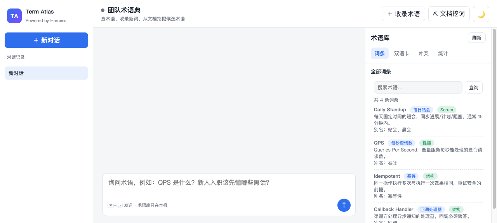
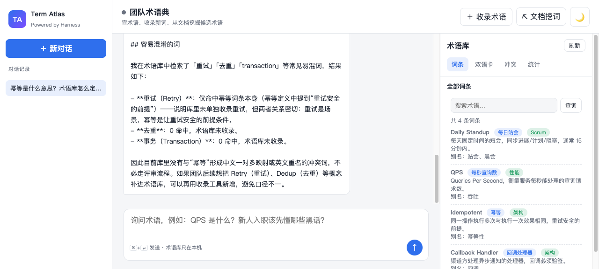
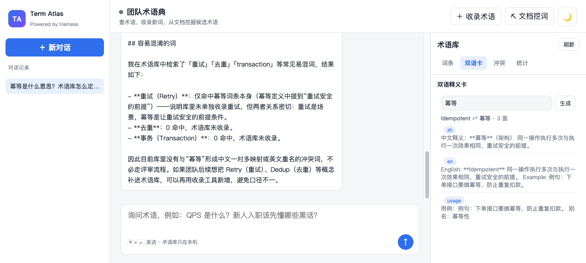

# DSH Term Atlas（团队术语典）

独立的 AI 原生产品：团队的中英术语/缩写/黑话库。查术语、收录新词、从文档批量挖候选术语、生成双语释义卡、检查术语冲突（重名/一对多映射）。AI 回答强制先查术语库，库里没有就明说"未收录"，禁止编造释义。

> 深度集成为 DSH（deepseek-harness-java）Java Native Plugin 生态的独立 AI 产品案例之一，Batch 1 收官之作（#5）。



## 功能

- **术语库**：词条 = 英文规范名 + 中文正名 + 别名 + 分类 + 释义 + 用例，持久化到 `~/.dsh-java-glossary/terms.json`，内置种子词条（Daily Standup / QPS / Idempotent）
- **模糊查询**：英文/中文/别名/释义全字段匹配
- **收录新词**：英文重名时不覆盖他人释义（红线），自动转**评审意见**
- **文档挖词**：驼峰词/连字符词/全大写缩写按频率排名，附「中文（即 English）」映射提示与是否已收录
- **双语卡片**：中文面 / 英文面 / 用例面三张，给新人解释术语或做分享物料
- **冲突检查**：英文重名、中文一对多映射、待评审意见数
- **AI 追问**：SSE 流式对话，强制先调 `gl_*` 工具查证再回答

## 工具（DSH Java Native Plugin）

插件 ID：`dsh-java-glossary-plugin`，工具前缀 `gl_`：

| 工具 | 说明 |
|------|------|
| `gl_lookup` | 按关键词查术语 |
| `gl_add_term` | 收录新词条（重名自动转评审，不覆盖） |
| `gl_mine_from_doc` | 从文档挖候选术语 |
| `gl_bilingual_card` | 生成双语释义卡（三面） |
| `gl_conflict_check` | 冲突检查（重名/一对多/待评审） |

## 快速开始

```bash
# 构建
mvn package -DskipTests

# 启动 app（端口 8116）
SERVER__PORT= java -jar dsh-java-glossary-app/target/dsh-java-glossary-app-0.1.0-SNAPSHOT.jar --server.port=8116

# 安装并激活插件到 harness（harness 默认 127.0.0.1:8090）
cp dsh-java-glossary-plugin/target/dsh-java-glossary-plugin-0.1.0-SNAPSHOT.jar ~/.dsh/standalone/plugins/dsh-java-glossary-plugin.jar
curl --noproxy '*' -X POST http://127.0.0.1:8090/api/harness/plugins/install -H 'Content-Type: application/json' \
  -d '{"pluginId":"dsh-java-glossary-plugin","jarName":"dsh-java-glossary-plugin.jar","displayName":"dsh-java-glossary-plugin","pluginVersion":"0.1.0","runtimeType":"JAVA_NATIVE","sourcePath":"'"$HOME"'/.dsh/standalone/plugins/dsh-java-glossary-plugin.jar","entrypoint":"dsh-java-glossary-plugin.jar","installMode":"NATIVE"}'
curl --noproxy '*' -X POST http://127.0.0.1:8090/api/harness/plugins/activate -H 'Content-Type: application/json' -d '{"pluginId":"dsh-java-glossary-plugin"}'
```

打开 <http://127.0.0.1:8116> 即可使用。

## E2E 测试

前置：app 已启动（8116）、harness 已启动（8090）、插件已安装激活、数据目录为空（重复跑先 `rm -rf ~/.dsh-java-glossary`，T1 依赖「Callback Handler」未被收录）。

```bash
python3 glossary_atlas_e2e.py
# 8/8 PASS：查询 / 收录 / 重复转评审 / 文档挖词 / 双语卡 / 冲突检查 / AI 工具调用 / 空关键词拒绝
```

## 截图

| 场景 | 图 |
|------|-----|
| 首页 + 词条面板 |  |
| AI 追问（查库比对易混词，未收录明说） |  |
| 双语释义卡（中/英/用例三面） |  |

## 安全边界（红线）

- **不删除已有词条、不改写他人释义**——冲突走评审意见，任何人（含 AI）不能直接覆盖
- 术语库中不存在的词，AI 必须回答"未收录"，禁止编造
- 数据仅存本机 `~/.dsh-java-glossary/`，不外发

## 技术

Java 17 · Spring Boot 3.3 · DSH Java Native Plugin（`AbstractHarnessPlugin`）· SSE 流式 · 端口 8116
